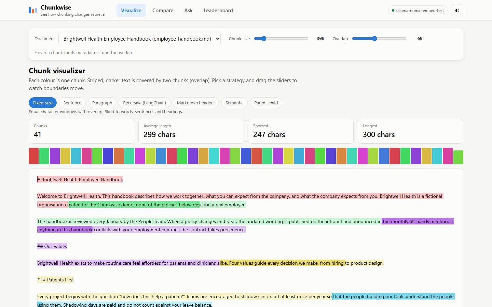
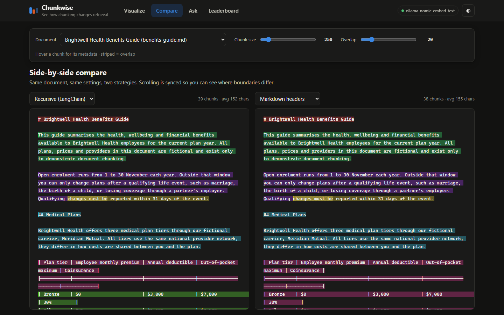
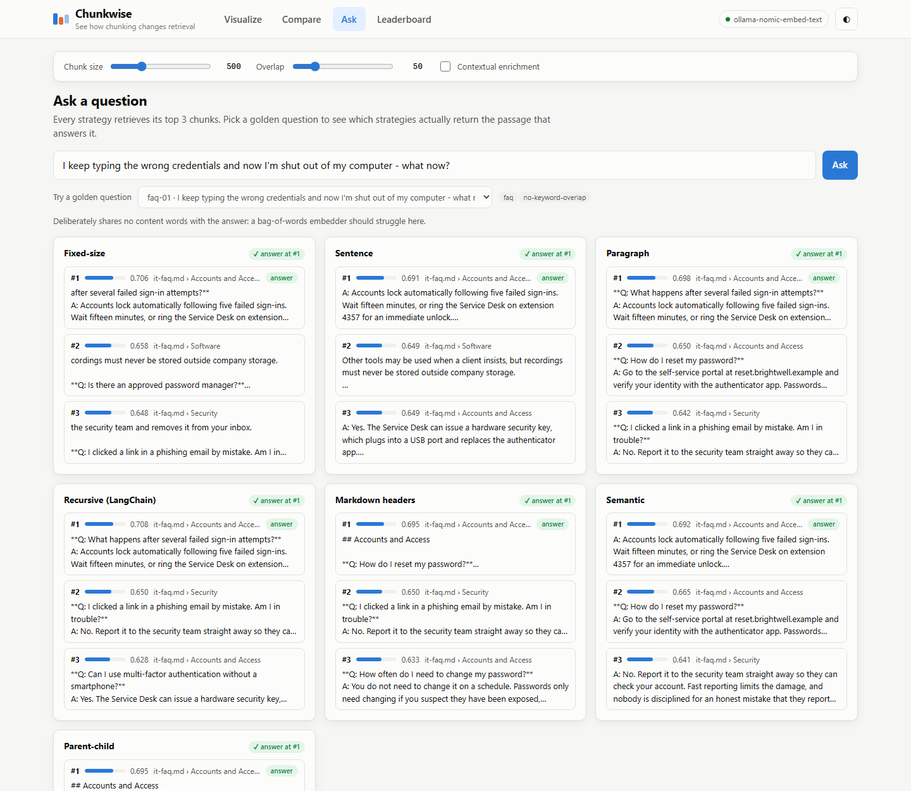
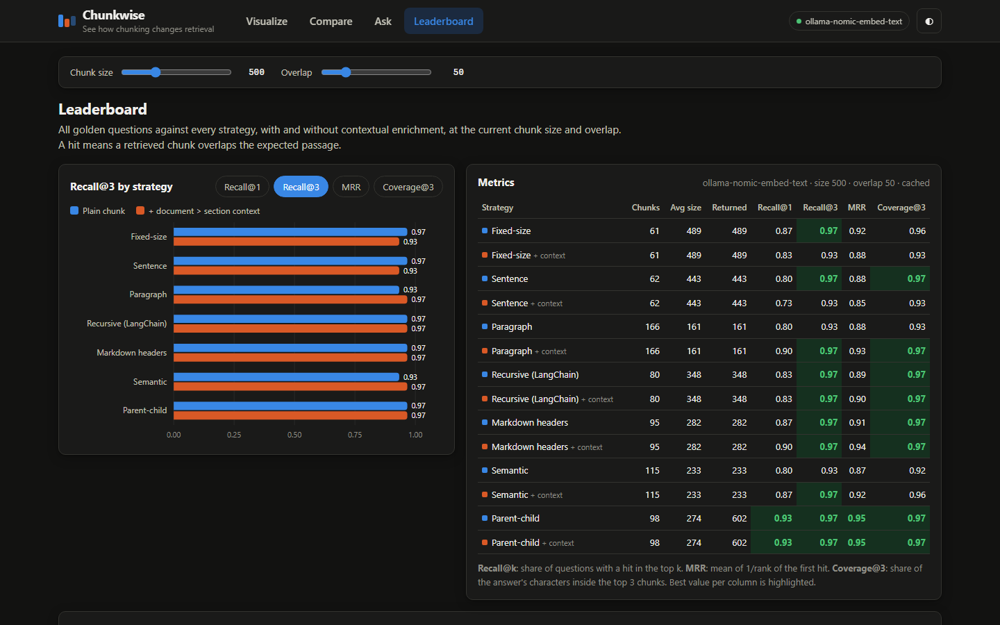
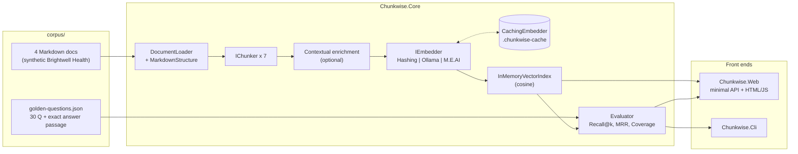

# Chunkwise

**A visual lab that shows, with numbers, how the way you chunk documents changes what a RAG system retrieves.**

[](https://github.com/vaishnaviakkewar19/Chunkwise/actions/workflows/ci.yml)


Seven chunking strategies, one synthetic knowledge base, 30 golden questions, and a browser UI that runs with zero setup.



<!-- Replace with a 2-minute demo GIF: docs/images/demo.gif -->

| Compare boundaries | Ask every strategy at once | Leaderboard |
|---|---|---|
|  |  |  |

## Why chunking matters

A retriever never sees your documents, only the chunks you cut them into. Cut a table away from its header row, a "this policy" sentence away from the heading that says *which* policy, or a two-paragraph answer down the middle, and the right information is no longer in any single chunk, however good your embedding model is. Chunking is the cheapest lever in a RAG pipeline and the easiest to get silently wrong. Chunkwise makes the effect visible and measurable.

## What's inside

- **7 chunkers** behind one `IChunker` interface: fixed-size, sentence, paragraph, recursive (a tested C# port of LangChain's `RecursiveCharacterTextSplitter`), Markdown-header-aware, semantic, and parent-child.
- **Contextual enrichment toggle**: optionally embed `"{document} > {section path}: "` + chunk text.
- **Pluggable embedders**: an offline hashing embedder (no setup, deterministic), Ollama (`nomic-embed-text`), or any `Microsoft.Extensions.AI` `IEmbeddingGenerator`, with a disk cache.
- **Evaluation harness**: Recall@1, Recall@3, MRR, Coverage@3, chunk count and size, plus a per-question rank grid.
- **Demo UI**: chunk visualizer with overlap shading, side-by-side compare, ask-all-strategies with source highlighting, leaderboard with chart and heatmap, live sliders, light and dark mode.
- **251 xUnit tests**, CI on Linux and Windows, a CLI for scripted runs.

## Quick start (zero setup)

Requires the [.NET 8 SDK](https://dotnet.microsoft.com/download/dotnet/8.0).

```bash
git clone https://github.com/vaishnaviakkewar19/Chunkwise.git
cd chunkwise
dotnet run --project src/Chunkwise.Web
```

Open **http://localhost:5080**. It uses the offline embedder, so there is nothing to install or configure.

Prefer the terminal?

```bash
dotnet run --project src/Chunkwise.Cli -- eval --details             # leaderboard + per-question ranks
dotnet run --project src/Chunkwise.Cli -- ask "How much is the remote work stipend?"
dotnet run --project src/Chunkwise.Cli -- chunks benefits-guide markdown --size 300
dotnet test                                                          # 251 tests
```

### The 2-minute demo

Every view is deep-linkable, so a demo can be a list of URLs:

| # | Talking point | Link |
|---|---|---|
| 1 | Fixed-size chunks cut words in half; overlap is shown striped | [`#visualize?doc=employee-handbook.md&strategy=fixed&size=300&overlap=60`](http://localhost:5080/#visualize?doc=employee-handbook.md&strategy=fixed&size=300&overlap=60) |
| 2 | The recursive splitter breaks a table away from its header; the Markdown chunker keeps it whole | [`#compare?doc=benefits-guide.md&left=recursive&right=markdown&size=250&overlap=20`](http://localhost:5080/#compare?doc=benefits-guide.md&left=recursive&right=markdown&size=250&overlap=20) |
| 3 | "This policy provides $75...": paragraph chunks return only the heading. Tick *Contextual enrichment* and watch it recover | [`#ask?q=hb-02`](http://localhost:5080/#ask?q=hb-02) |
| 4 | Drag the chunk-size slider and watch the metrics move | [`#leaderboard`](http://localhost:5080/#leaderboard) |

Add `&theme=dark` to any link.

## Architecture



A more detailed, editable diagram (projects, indexing, query and evaluation flows) is in [`docs/architecture.excalidraw`](docs/architecture.excalidraw). Open it at [excalidraw.com](https://excalidraw.com) or with the VS Code Excalidraw extension.

| Project | Role |
|---|---|
| `src/Chunkwise.Core` | Class library: documents, chunkers, embedders, vector index, evaluation. One dependency: `Microsoft.Extensions.AI.Abstractions`. |
| `src/Chunkwise.Web` | ASP.NET Core minimal API plus a static `wwwroot` UI (no npm, no build step). |
| `src/Chunkwise.Cli` | `chunkwise eval | ask | chunks` for scripted runs and README tables. |
| `tests/Chunkwise.Tests` | xUnit: invariants for every chunker, LangChain parity, metrics, embedders, HTTP API. |
| `corpus/` | The synthetic knowledge base and golden questions (all invented content). |

## The corpus

**Brightwell Health** is a fictional company. Its knowledge base deliberately mixes document types that need different chunking:

| Document | Shape | What it stresses |
|---|---|---|
| `employee-handbook.md` | Long prose, nested headings | Section boundaries, co-reference to headings |
| `benefits-guide.md` | Markdown tables (plan tiers, copays) | Tables split away from their header row |
| `api-docs.md` | C# and JSON code blocks | Code samples cut in half |
| `it-faq.md` | Short Q/A pairs | Tiny, self-contained units |

The 30 golden questions include deliberately tricky cases:
- `hb-07`: an answer that spans **two paragraphs**.
- `hb-02`: a sentence that says **"This policy..."** and only makes sense with its heading.
- `faq-01`, `bn-06`: questions that share **no keywords** with their answers.

## Results

`nomic-embed-text` via Ollama · chunk size 500 · overlap 50 · 30 questions · produced by `chunkwise eval --embedder ollama --markdown` (raw output in [`docs/results/`](docs/results/)).

| Strategy | Chunks | Avg size | Returned | Recall@1 | Recall@3 | MRR | Coverage@3 |
|---|---:|---:|---:|---:|---:|---:|---:|
| Fixed-size | 61 | 489 | 489 | 0.87 | **0.97** | 0.92 | 0.96 |
| Fixed-size + context | 61 | 489 | 489 | 0.83 | 0.93 | 0.88 | 0.93 |
| Sentence | 62 | 443 | 443 | 0.80 | **0.97** | 0.88 | **0.97** |
| Sentence + context | 62 | 443 | 443 | 0.73 | 0.93 | 0.85 | 0.93 |
| Paragraph | 166 | 161 | 161 | 0.80 | 0.93 | 0.88 | 0.93 |
| Paragraph + context | 166 | 161 | 161 | 0.90 | **0.97** | 0.93 | **0.97** |
| Recursive (LangChain) | 80 | 348 | 348 | 0.83 | **0.97** | 0.89 | **0.97** |
| Recursive (LangChain) + context | 80 | 348 | 348 | 0.83 | **0.97** | 0.90 | **0.97** |
| Markdown headers | 95 | 282 | 282 | 0.87 | **0.97** | 0.91 | **0.97** |
| Markdown headers + context | 95 | 282 | 282 | 0.90 | **0.97** | 0.94 | **0.97** |
| Semantic | 115 | 233 | 233 | 0.80 | 0.93 | 0.87 | 0.92 |
| Semantic + context | 115 | 233 | 233 | 0.87 | **0.97** | 0.92 | 0.96 |
| Parent-child | 98 | 274 | 602 | **0.93** | **0.97** | **0.95** | **0.97** |
| Parent-child + context | 98 | 274 | 602 | **0.93** | **0.97** | **0.95** | **0.97** |

*Returned* = average characters handed to the LLM per result (for parent-child, the parent).

<details>
<summary>Same run with the offline hashing embedder (what you get with zero setup)</summary>

| Strategy | Chunks | Avg size | Returned | Recall@1 | Recall@3 | MRR | Coverage@3 |
|---|---:|---:|---:|---:|---:|---:|---:|
| Fixed-size | 61 | 489 | 489 | 0.80 | 0.90 | 0.85 | 0.86 |
| Fixed-size + context | 61 | 489 | 489 | 0.73 | 0.90 | 0.82 | 0.86 |
| Sentence | 62 | 443 | 443 | 0.77 | 0.87 | 0.83 | 0.84 |
| Sentence + context | 62 | 443 | 443 | 0.80 | 0.87 | 0.85 | 0.85 |
| Paragraph | 166 | 161 | 161 | 0.37 | 0.60 | 0.54 | 0.58 |
| Paragraph + context | 166 | 161 | 161 | 0.43 | 0.83 | 0.65 | 0.82 |
| Recursive (LangChain) | 80 | 348 | 348 | 0.73 | **0.97** | 0.84 | **0.97** |
| Recursive (LangChain) + context | 80 | 348 | 348 | 0.77 | **0.97** | 0.86 | **0.97** |
| Markdown headers | 95 | 282 | 282 | 0.73 | **0.97** | 0.84 | **0.97** |
| Markdown headers + context | 95 | 282 | 282 | 0.77 | 0.90 | 0.84 | 0.90 |
| Semantic | 110 | 244 | 244 | 0.47 | 0.83 | 0.65 | 0.83 |
| Semantic + context | 110 | 244 | 244 | 0.60 | 0.90 | 0.75 | 0.88 |
| Parent-child | 98 | 274 | 602 | 0.83 | **0.97** | 0.89 | **0.97** |
| Parent-child + context | 98 | 274 | 602 | **0.87** | 0.93 | **0.90** | 0.93 |

</details>

### Findings

1. **Parent-child is the most accurate, and it costs about 2x the context.** Searching 274-character children and returning their ~600-character parents gives the best Recall@1 (0.93) and MRR (0.95). Small chunks match a question precisely; big ones give the LLM enough to answer. The price is more tokens per result, which is why the *Returned* column exists.
2. **Contextual enrichment helps section-aligned chunks and hurts window-style ones.** Prefixing `"Document > Section:"` lifts Paragraph Recall@1 from 0.80 to 0.90, Semantic from 0.80 to 0.87 and Markdown from 0.87 to 0.90. It *lowers* Fixed-size (0.87 to 0.83) and Sentence (0.80 to 0.73): those chunks straddle several sections, so a single breadcrumb mislabels part of their text. Enrichment and structure-aware chunking belong together.
3. **On paraphrased questions, the embedder matters more than the chunker.** `faq-01` ("shut out of my computer" vs "accounts lock... failed sign-ins") is missed by all 14 configurations with the bag-of-words embedder and found at rank 1 by all 14 with `nomic-embed-text`. Semantic chunking depends on a real model even more: its Recall@1 is 0.47 with hashing and 0.80 with nomic.
4. **Structure-blind splitting orphans headings and breaks tables.** With the offline embedder, plain paragraph chunking scores just 0.60 Recall@3, because headings like `### Remote Work Stipend` become chunks of their own that out-score the paragraph that actually answers the question (demo step 3 shows all three of its results are bare headings). The recursive splitter also separates the plan-tier table's header from its rows (Compare screenshot), while the Markdown chunker keeps tables and code samples intact.

> **Read these numbers as directional.** 30 questions means each question is worth 0.033, and Recall@3 saturates around 0.97 for most strategies; the one miss is usually `bn-06` ("Will my boss find out if I see a therapist?"), which no strategy ranks in its top 3 except Sentence. Recall@1 and MRR are where the strategies separate. The corpus is small and synthetic by design, so the point is the *method*, not a universal ranking.

## Evaluation method

For each strategy, with and without enrichment: chunk all four documents, embed the chunks, then run every golden question against the **whole corpus**, not just its own document.

- **Hit**: a retrieved chunk is from the right document and its character span **overlaps** the expected answer passage.
- **Recall@k**: share of questions with a hit in the top *k*.
- **MRR** (cut-off 10): mean of 1 / rank of the first hit. It rewards ranking the answer higher, not just finding it.
- **Coverage@3**: share of the answer's characters inside the union of the top 3 results. It catches "technically a hit, but only half the answer".

## Optional: real embeddings with Ollama

```bash
# 1. Install Ollama from https://ollama.com, then:
ollama pull nomic-embed-text

# 2a. Web UI
#     bash:        Chunkwise__Embedder__Provider=ollama dotnet run --project src/Chunkwise.Web
#     PowerShell:  $env:Chunkwise__Embedder__Provider="ollama"; dotnet run --project src/Chunkwise.Web
# 2b. CLI
dotnet run --project src/Chunkwise.Cli -- eval --embedder ollama
```

Or set `"Provider": "ollama"` in `src/Chunkwise.Web/appsettings.json`. Any Ollama embedding model works (`--ollama-model bge-m3`).

- **Caching:** vectors are cached in `.chunkwise-cache/` at the repo root, shared by the CLI and the web app. The first full nomic run takes a few minutes on a laptop CPU; re-runs take about a second.
- **Fallback:** if Ollama isn't running, the web app falls back to the offline embedder and shows a banner instead of failing.

To use a hosted model, wrap any `IEmbeddingGenerator<string, Embedding<float>>` (OpenAI, Azure OpenAI, ONNX) in `EmbeddingGeneratorEmbedder`.

## Design decisions

Where the brief was ambiguous, I picked a default, wrote it down here, and kept going.

**Data model**
- **Spans, not strings.** Every chunk is a `[start, end)` range into the original text. The visualizer, overlap shading and evaluation hit test are all interval arithmetic on one coordinate system, so they can't disagree.
- **Characters, not tokens.** Sizes are measured in characters: deterministic, dependency-free and easy to show on a slider. For English, roughly 4 characters is one token.
- **Golden answers are stored as text, not offsets.** Offsets go stale silently when someone edits the corpus. Answers are located at load time, and loading fails loudly if an answer is missing or ambiguous.
- **Line endings are normalised to `\n` on load**, so offsets are identical on Windows and Linux. CI runs on both.

**Chunkers**
- **The LangChain port is span-based** and implements the default `keep_separator=True` behaviour. It is verified against the expected output of LangChain's own `test_iterative_text_splitter`.
- **Fixed-size chunks are not whitespace-trimmed**, so the configured overlap is exact.
- **Sentence splitting is rule-based.** Every newline also ends a sentence, so table rows, code lines and Q/A lines are units. A real segmenter (ICU, spaCy) would handle abbreviations better.
- **The Markdown chunker may exceed the size limit** to keep a code block or table whole. Half a table loses its header; half a code sample doesn't compile. This is the only exception the tests allow.
- **Section paths leave out the H1** (it's the document title) and are taken at the chunk's first visible character.
- **The semantic threshold is a percentile, not a cosine value.** Neighbouring-sentence similarity is about 0.1–0.3 with the hashing embedder and 0.5–0.9 with nomic, so an absolute cut-off can't work for both. `0.25` means "cut at this document's least-similar 25% of boundaries" (LangChain's percentile mode). Each sentence is embedded with one neighbour either side to reduce noise. Defaults were picked from a small sweep (0.1–0.6).
- **Parent-child parents are Markdown sections** capped at `max(1500, 3 × chunk size)` in the UI (1500 in the CLI, `--parent-size`), with no overlap. The *parent* span is scored, because that's what the LLM would see. Children sharing a parent are de-duplicated in results, like LangChain's `ParentDocumentRetriever`.

**Retrieval and evaluation**
- **Contextual enrichment uses the heading breadcrumb, not an LLM.** It's the cheap version of Anthropic's "contextual retrieval". It changes only the embedded text, never offsets or what is displayed.
- **A hit is "any overlap"**, as specified. Because that's generous, I added Coverage@3 and the Returned column, so lenient matching and large parents can't flatter a strategy.

**Embedders**
- **Own `IEmbedder` interface, not `IEmbeddingGenerator` everywhere.** Retrieval needs a query/document distinction (nomic expects `search_query:` / `search_document:` prefixes), and plain `float[]` keeps the index simple. `Microsoft.Extensions.AI` plugs in through an adapter.
- **The hashing embedder** hashes unigrams and bigrams into 1024 signed buckets with FNV-1a (`string.GetHashCode` is randomised per process). It applies stop-word removal, a tiny stemmer and camelCase splitting, and uses no IDF. It is intentionally weak at paraphrase, which is what makes finding 3 visible.
- **Ollama is called with a raw `HttpClient`**: one POST, so the request stays visible rather than hidden in an SDK.
- **Embedding cache**: content-addressed by SHA-256 of model, input kind and text, so it can never serve a stale vector. It is anchored at the repo root, so the CLI and web app share it.

**Infrastructure and UI**
- **Brute-force in-memory search.** A few hundred vectors take well under a millisecond, and exact search adds no approximation error to the comparison.
- **The web API clamps slider input** (size 50–2000, overlap ≤ size/2) rather than rejecting it, so the UI can't be broken by a bad value.
- **No frontend build step.** Plain ES modules and hand-drawn SVG. All corpus text is inserted with `textContent`, never `innerHTML`.

## Roadmap

- [ ] **Re-ranking**: a cross-encoder (e.g. `bge-reranker`) over the top 20, to see whether it closes the gap between strategies.
- [ ] **Hybrid search**: BM25 + vector with reciprocal-rank fusion, the classic fix for keyword-heavy questions such as copay amounts and error codes.
- [ ] **pgvector**: persist indexes in PostgreSQL to show the same evaluation against a real vector store.
- [ ] **LLM answer generation**: generate answers through `IChatClient` (`Microsoft.Extensions.AI`) with citations back to character offsets, and score faithfulness.
- [ ] Token-based sizing (`Microsoft.ML.Tokenizers`) alongside characters.
- [ ] Bring-your-own corpus: upload Markdown and generate candidate golden questions.

## License

[MIT](LICENSE). All Brightwell Health content in `corpus/` is invented for this project.
